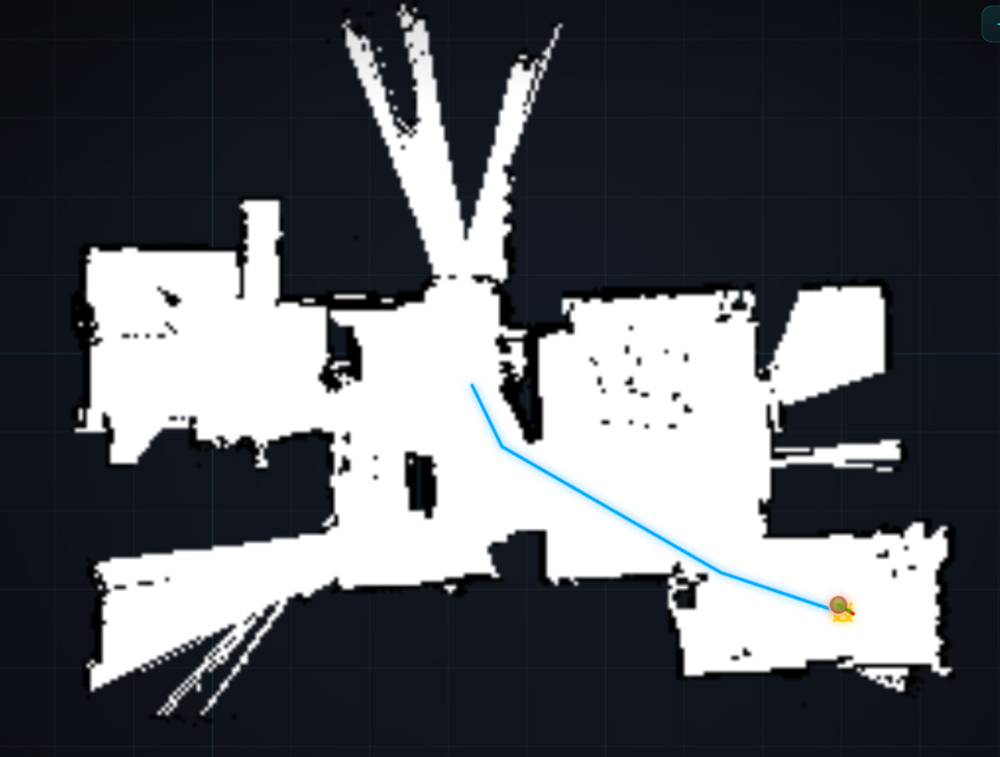
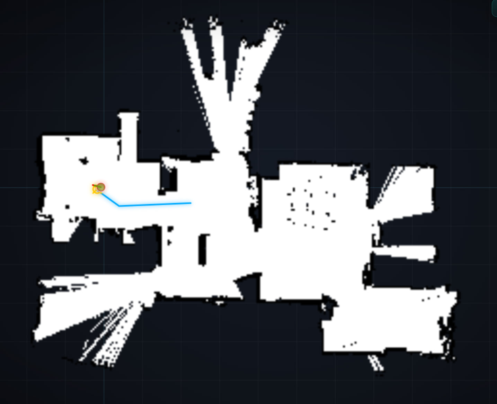
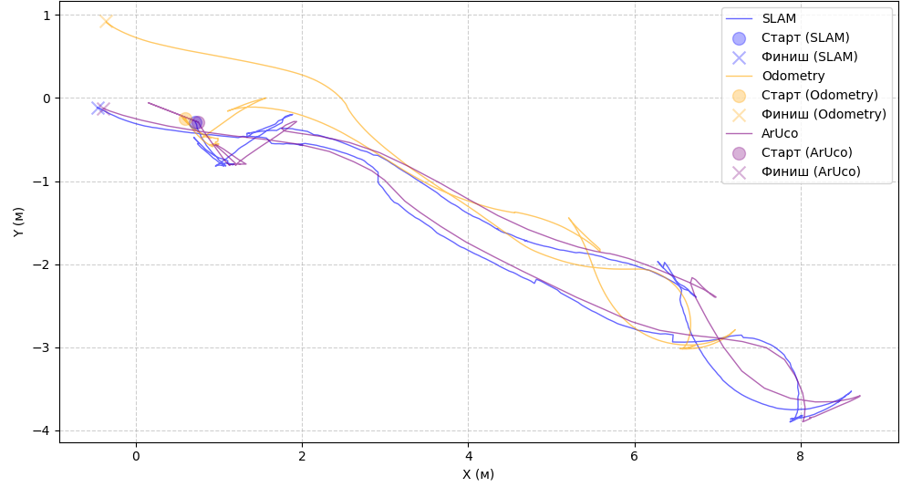

# v2bot
### Autonomous navigation stack built from scratch

The navigation stack consists of:
- ROS-like communication system - [MiniROS](https://github.com/Vadimych1/MiniROS)
- GICP-based Graph SLAM - [VGSLAM](https://github.com/Vadimych1/vgslam) + [src/vgslam_slam](src/vgslam_slam)
- Global path planner using Rapidly Exploring Random Tree Star (RRT*) - [src/path_planner](src/path_planner)
- Local path planner using Dynamic Window Approach (DWA) - [src/motion_controller](src/motion_controller)
- Goal manager via web interface - [src/visual_goal_manager](src/visual_goal_manager)
- Motor driver for differential drive on Arduino with odometry and its MiniROS wrapper - [src/motor_controller](src/motor_controller) + [src/motor_controller/ardu_sketch](src/motor_controller/ardu_sketch)
- Simple configuration module - [src/configurator](src/configurator)
- RPLidar A1 pipe for MiniROS - [src/lidar](src/lidar)
- Logging module - [src/stats](src/stats)
- (unused for now) Camera module - [src/camera](src/camera)

The new things added to algorithms implementations are:
1. RRT* uses a few optimizations, for example fast and reliable node index for better speed and Python data structures for lower memory consumption compared to dicts
2. DWA uses these weights: heading, decision deviation, commitment, progress, distance, speed, reverse & stationary penalties, obstacle, path deviation. The new thing is that DWA uses FMM (Fast Marching Method) to calculate the distance to the target and moving progress. Also the FMM's gradient is used to calculate the preferred movement direction (the part of heading cost). This makes DWA not just local planning algorithm, but also globally-oriented. That means that local plans should be more optimal to match global environment features and also enables realtime obstacle avoidance without changing the global path. Current implementation also uses EDT (Euclidean Distance Transform) to calculate clearance, but this seems to be a common thing

The system is tested and works pretty well in residential settings. There are SLAM-build map and trajectories comparison:
1. SLAM map before a loop closure:

2. SLAM map after a loop closure:

3. Trajectory comparison:

Navigation system works, although it definitely needs some configuration to make local planning better in some complex situations

Some measured stats:
1. the system uses approximately 600Mb of memory on Raspberry Pi 5; mean CPU load was 21% with peaks up to 60% when global planner was working
2. RRT* planning takes 0.14±0.08 seconds, with maximum measured value of 0.34 seconds. Map resolution 20 px per meter, map size is approximately 12 by 8 meters (see image (2))
3. DWA iterations takes approximately 0.02 seconds, which allows to run the local planning on ~50Hz
4. ATE of SLAM measured as 0.15±0.07 meters compared to ArUco-based trajectory; RPE is 0.044±0.015 m on 1 meter distance delta and 0.024±0.008 on 2 meter delta

### Running the system
You need to install Python>=3.10 and [MiniROS](https://github.com/Vadimych1/MiniROS)

1. Clone this repository
2. For every package in directory `src` run: `miniros install src/<package_name>`
3. Start the MiniROS server: `miniros server`
4. Run all the packages you need (the default run required lidar, motion_controller, motor_controller, path_planner, vgslam_slam and visual_goal_manager) with command `miniros run <package>`

Note that you always can change the code or write your own modules (for example SLAM library wrappers). They will be compatible with the whole system while you are using same MiniROS types of data as the original package was
